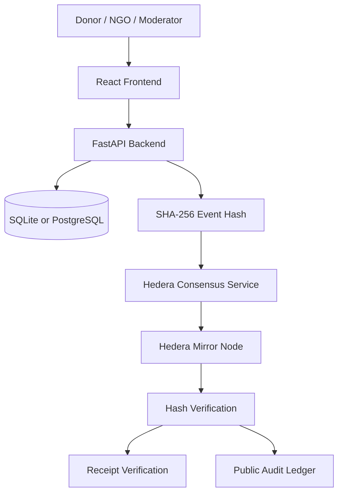

# Amanah

<p align="center">
  
  <br />
  <strong>Amanah</strong>
  <br />
  <em>Transparent Humanitarian Aid</em>
</p>

<p align="center">
  Verifiable humanitarian aid records powered by
  <strong>Hedera Consensus Service (HCS)</strong>.
</p>

<p align="center">
  <a href="https://hashscan.io/testnet/topic/0.0.10972610">Hedera HCS Topic</a>
  ·
  <a href="https://testnet.mirrornode.hedera.com/api/v1/topics/0.0.10972610/messages">Mirror Node</a>
</p>

## Overview

Amanah is a full-stack humanitarian donation platform built for the Hedera hackathon. It connects donors, approved NGO administrators, and moderators in one auditable workflow:

1. An NGO administrator applies and starts in a pending state.
2. A moderator approves or rejects the application.
3. An approved NGO creates an aid campaign.
4. A donor opens the campaign's external donation page.
5. The NGO records the completed donation in its dashboard.
6. Amanah anchors the donation on Hedera Consensus Service and generates a receipt token.
7. Anyone can verify the receipt and inspect the ledger entry.

## Features

- Public campaign discovery with live fundraising progress.
- Role-based authentication for donors, NGO administrators, and moderators.
- Moderator-only NGO approval table.
- NGO-specific campaign management.
- Donation confirmation and receipt-token generation.
- Hedera HCS anchoring with transaction and HashScan references.
- Public receipt verification from the main navigation.
- Unified audit ledger containing aid events and confirmed donations.
- Responsive React interface with local SVG branding and campaign artwork.

## How Hedera powers Amanah

- **Consensus ordering:** HCS orders submitted messages and provides consensus metadata.
- **Tamper evidence:** SHA-256 hashes help detect changes to donation and aid-event data.
- **Independent retrieval:** The Hedera Mirror Node API exposes recorded topic messages for verification.
- **Public auditability:** HashScan lets users inspect the associated testnet topic and transactions.

## Architecture



## Logo SVG

The logo is stored at [`frontend/public/amanah-logo.svg`](frontend/public/amanah-logo.svg) and is used as the app favicon, authentication branding, and navbar logo.

```svg
<svg xmlns="http://www.w3.org/2000/svg" viewBox="0 0 128 128" role="img" aria-labelledby="title desc">
  <title id="title">Amanah</title>
  <desc id="desc">A green shield with a humanitarian heart and an immutable ledger line</desc>
  <defs>
    <linearGradient id="emerald" x1="18" y1="12" x2="110" y2="116" gradientUnits="userSpaceOnUse">
      <stop stop-color="#10b981"/>
      <stop offset="1" stop-color="#047857"/>
    </linearGradient>
  </defs>
  <rect width="128" height="128" rx="30" fill="#064e3b"/>
  <path d="M64 15 105 31v28c0 27-16 43-41 54C39 102 23 86 23 59V31l41-16Z" fill="url(#emerald)"/>
  <path d="M64 39c-8-11-26-5-26 9 0 14 16 24 26 31 10-7 26-17 26-31 0-14-18-20-26-9Z" fill="#fff" opacity=".97"/>
  <path d="M45 79h38M45 88h22" stroke="#d1fae5" stroke-width="5" stroke-linecap="round"/>
  <path d="m53 79 6-6 6 6 7-7" fill="none" stroke="#047857" stroke-width="3.5" stroke-linecap="round" stroke-linejoin="round"/>
</svg>
```

## Tech stack

- **Frontend:** React 19, TypeScript, Vite, React Router, Leaflet
- **Backend:** FastAPI, SQLAlchemy, Pydantic Settings, Uvicorn
- **Database:** SQLite for local development or PostgreSQL-compatible deployments
- **Blockchain:** Hedera Consensus Service testnet

## Project structure

```text
amanah/
├── backend/
│   ├── app/
│   ├── scripts/
│   ├── tests/
│   ├── requirements.txt
│   └── .env.example
├── frontend/
│   ├── public/
│   ├── src/
│   ├── package.json
│   └── .env.example
└── README.md
```

## Prerequisites

- Python 3.11+
- Node.js 20+
- pnpm
- A Hedera testnet account and topic for real on-chain anchoring

## Local setup

### 1. Backend

```powershell
cd backend
python -m venv .venv
.venv\Scripts\Activate.ps1
pip install -r requirements.txt
Copy-Item .env.example .env
```

Update `backend/.env` with your database and Hedera testnet credentials. Never commit `.env`.

Start the API:

```powershell
uvicorn app.main:app --reload --port 8000
```

The API is available at `http://127.0.0.1:8000`. OpenAPI documentation is available at `/docs`.

### 2. Frontend

In a second terminal:

```powershell
cd frontend
pnpm install
Copy-Item .env.example .env
pnpm dev
```

The Vite development server prints the local URL, normally `http://localhost:5173`.

## Validation

Backend tests:

```powershell
cd backend
pytest -q
```

Frontend checks:

```powershell
cd frontend
pnpm run lint
pnpm run build
```

## Demo account

The seeded moderator account used for a local demo is:

```text
Email: moderator@amanah.com
Password: Amanah123456!
```

Use it only for local demonstrations. For a complete demo, first register an NGO administrator, approve that application with the moderator account, create a campaign, record a donation as the NGO administrator, and verify the generated receipt from the public navbar.

## API workflow

| Purpose | Endpoint | Access |
| --- | --- | --- |
| Login | `POST /auth/login` | Public |
| Current user | `GET /auth/me` | Authenticated |
| Register NGO | `POST /ngos/` | Public |
| NGO status | `GET /ngos/me/status` | NGO administrator |
| Review NGO applications | `GET /ngos/` | Moderator |
| Approve or reject NGO | `PATCH /ngos/{id}/verification` | Moderator |
| Public campaigns | `GET /campaigns/` | Public |
| NGO campaigns | `GET /campaigns/mine` | Verified NGO administrator |
| Record donation | `POST /campaigns/{id}/donations/record` | Verified NGO administrator |
| Verify receipt | `GET /donations/receipt/{token}` | Public |
| Recent ledger entries | `GET /events/recent` | Public |

## Security notes

- Keep all credentials in local environment files or a secret manager.
- Use a unique production JWT secret.
- Use a dedicated Hedera account with the minimum required testnet permissions.
- Do not use the demo moderator password in production.
- Rotate any credential that has ever been exposed outside a protected local environment.

## Testnet transparency

Amanah currently uses **Hedera Testnet**, not Mainnet.

- HCS topic: [`0.0.10972610`](https://hashscan.io/testnet/topic/0.0.10972610)
- [View recorded topic messages](https://testnet.mirrornode.hedera.com/api/v1/topics/0.0.10972610/messages)

> **Trust model:** A matching hash demonstrates consistency with a consensus-recorded message. It does not independently prove that funds were received or that aid was physically delivered; supporting evidence and oversight remain necessary.

## License

This project is provided for the Hedera hackathon demonstration. Add a project-specific license before distributing it publicly.
