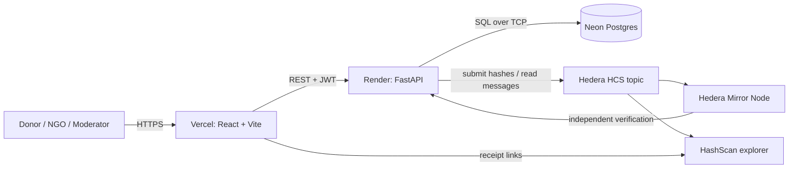
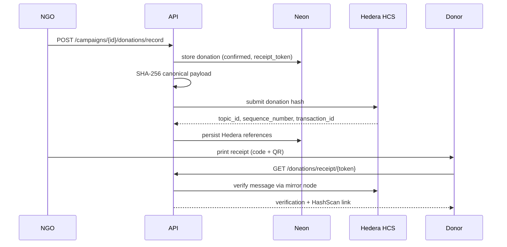
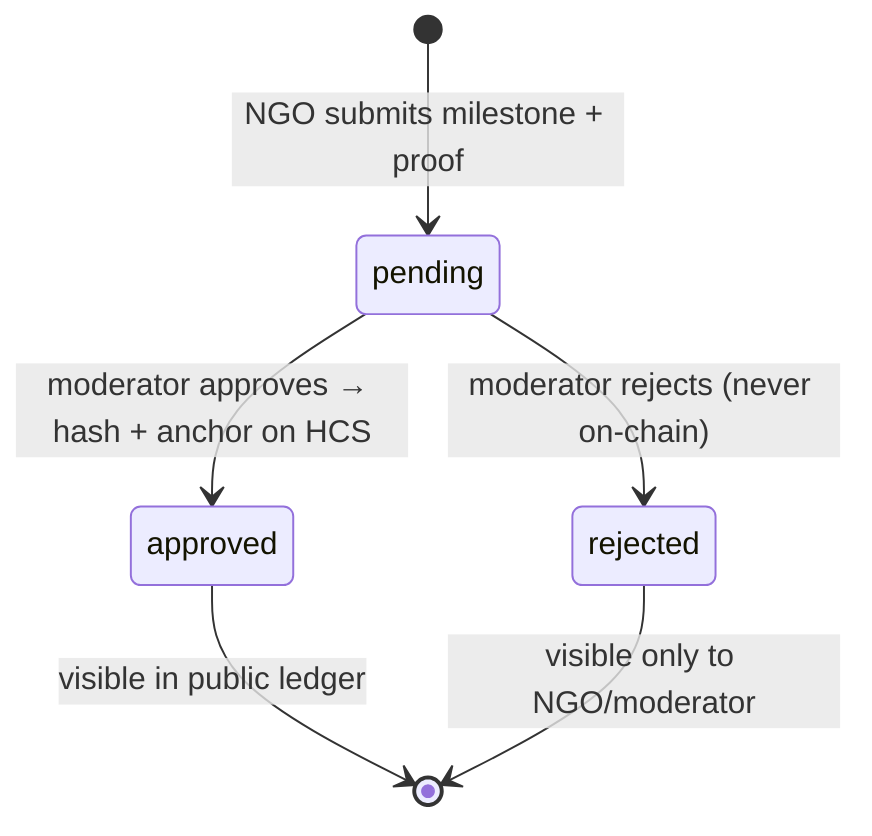

<div align="center">


# Amanah

**Transparent humanitarian aid, anchored on Hedera Consensus Service.**


</div>

---

## Why Amanah exists (and why Hedera matters)

Humanitarian aid is usually tracked in private databases. Donors must trust the organisation's
own records, and there is no independent way to prove that a reported delivery actually happened.

Amanah is a hackathon prototype that makes aid **auditable by design**. Every financially
meaningful event — a donation, an expense, a verified delivery milestone, a public campaign
update — is converted into a canonical JSON payload, hashed with **SHA-256**, and submitted to a
**Hedera Consensus Service (HCS)** topic. Hedera gives each message:

- an immutable, timestamped position in the topic (`sequence_number`),
- a consensus timestamp and running hash verifiable via the public mirror node,
- a public HashScan transaction link anyone can inspect.

The database (Neon Postgres) stores the application state and the Hedera references; it is **not**
the sole source of truth. Anyone can independently recompute the hash of a receipt or milestone and
compare it with the on-chain message. That is the core value of the project for the Hedera
hackathon: **cryptographic accountability instead of institutional trust**.

---

## Features

- Role-based access for **platform moderators** and **NGO administrators** (donations are anonymous).
- NGO registration and a moderator approval queue.
- NGO-owned aid campaigns with funding progress, location and map visualisation.
- Anonymous donation recording with an issued **receipt token and printable QR code**
  (download PNG/SVG or print).
- **Moderated aid milestones**: NGO submits a milestone with proof; a moderator approves or rejects
  it with a note. Only approved milestones become public and are anchored on Hedera.
- Campaign updates and recorded expenses — all hashed and anchored on HCS.
- Unified **donation-to-delivery ledger** that combines donations, expenses, milestones and updates.
- **Phone ↔ PC QR pairing**: a desktop pairing QR opens a mobile page that scans the QR printed on
  a paper receipt and pushes the result back to the desktop for verification.
- Public receipt verification by token, with mirror-node validation and HashScan links.

## Architecture



### Donation → on-chain receipt



### Milestone moderation



## Tech stack

| Layer | Technology |
| --- | --- |
| Frontend | React 19, TypeScript, Vite, Leaflet + MapLibre, `qrcode` |
| Backend | FastAPI, SQLAlchemy, Pydantic, Uvicorn, `hiero-sdk-python` |
| Database | Neon Postgres holds application state; Hedera HCS holds the proof |
| Blockchain | Hedera Consensus Service (testnet), verified via mirror node |
| Hosting | Vercel (frontend), Render (backend) |

## Project structure

```text
amanah/
├── backend/
│   ├── app/
│   │   ├── routes/        # auth, ngos, campaigns, events, updates, pairing
│   │   ├── services/      # Hedera hashing, submission and verification
│   │   ├── auth.py        # JWT + role guards
│   │   ├── database.py    # engine / session (DATABASE_URL required)
│   │   ├── main.py        # app, CORS, startup schema checks, /network
│   │   ├── models.py      # SQLAlchemy models
│   │   └── schemas.py     # Pydantic DTOs
│   ├── scripts/           # optional local/demo utilities (not runtime data)
│   ├── tests/             # isolated test DB + mocked mirror node
│   └── requirements.txt
├── frontend/
│   ├── public/            # logo and static assets
│   └── src/
│       ├── components/    # UI, modals, panels, QR pairing
│       ├── utils/         # geo helpers, site URL, Hedera network config
│       └── types.ts
└── README.md
```

## Local setup

> **Neon holds state; Hedera holds proof.** The app requires `DATABASE_URL` to be set. On a machine
> where outbound PostgreSQL (port 5432) is blocked, you can override it with a temporary SQLite
> URL for development only:
> `$env:DATABASE_URL="sqlite:///./amanah.db"`

### Backend

```powershell
cd backend
python -m venv .venv
.venv\Scripts\Activate.ps1
pip install -r requirements.txt
Copy-Item .env.example .env   # then fill in real values
uvicorn app.main:app --reload --port 8000
```

OpenAPI docs: `http://127.0.0.1:8000/docs`.

| Variable | Purpose |
| --- | --- |
| `DATABASE_URL` | Neon Postgres connection string (required) |
| `JWT_SECRET_KEY` | 32+ character signing secret (required) |
| `HEDERA_NETWORK` | `testnet` (default) or `mainnet` |
| `HEDERA_ACCOUNT_ID`, `HEDERA_PRIVATE_KEY` | Operator credentials for HCS submissions |
| `HEDERA_TOPIC_ID` | HCS topic used for all anchored records |
| `FRONTEND_URLS` | Comma-separated extra CORS origins (e.g. Vercel URL) |

### Frontend

```powershell
cd frontend
pnpm install
Copy-Item .env.example .env
pnpm dev
```

| Variable | Purpose |
| --- | --- |
| `VITE_API_URL` | Backend base URL |
| `VITE_SITE_URL` | Public frontend URL embedded in pairing QR codes |
| `VITE_CARTO_KEY` | Public CARTO basemap key (frontend build-time only) |

## Demo accounts (on Neon)

```text
Moderator:   moderator@amanah.com     / Amanah123456!
NGO admin:   contact@globalhope.org   / Amanah123456!
```

These are demo-only credentials. For a fresh local SQLite database they can be created with
`python scripts/setup_demo_accounts.py` from `backend/`.

## API overview

| Purpose | Endpoint | Access |
| --- | --- | --- |
| Login / current user | `POST /auth/login`, `GET /auth/me` | Public / authenticated |
| Register NGO | `POST /ngos/` | Public |
| NGO status | `GET /ngos/me/status` | NGO administrator |
| Review NGOs | `GET /ngos/`, `PATCH /ngos/{id}/verification` | Moderator |
| Campaigns | `GET /campaigns/`, `GET /campaigns/{id}`, `POST /campaigns/` | Public / NGO |
| Record donation | `POST /campaigns/{id}/donations/record` | NGO |
| Verify receipt | `GET /donations/receipt/{token}` | Public |
| Milestones | `GET/POST /campaigns/{id}/events`, `GET /moderation/events`, `POST /events/{id}/review` | Mixed |
| Updates / expenses | `GET/POST /campaigns/{id}/updates`, `.../expenses` | Public / NGO |
| Donation-to-delivery chain | `GET /campaigns/{id}/chain` | Public |
| QR pairing | `/pairing/sessions...` | Public |
| Recent ledger | `GET /events/recent` | Public |
| Hedera network metadata | `GET /network` | Public |

## Validation

```powershell
cd backend && pytest -q     # isolated SQLite + deterministic mirror mock
cd frontend && pnpm run lint && pnpm run build
```

## Deployment (Render + Vercel + Neon)

1. **Neon** — keep the database there; use the pooler connection string.
2. **Render Web Service** — build `pip install -r requirements.txt`, start
   `uvicorn app.main:app --host 0.0.0.0 --port $PORT`; set `DATABASE_URL`, `JWT_SECRET_KEY`,
   `HEDERA_*` and `FRONTEND_URLS=<Vercel URL>`. Health check path: `/`.
3. **Vercel (Vite preset)** — repository root `frontend`, build `pnpm build`, output `dist`; set
   **build-time** variables `VITE_API_URL=<Render URL>` and `VITE_SITE_URL=<Vercel URL>`.

The phone page uses hash routing (`#/scan/{code}`), so no rewrite rules are needed.
Startup applies idempotent schema checks; no manual Neon migration is required.

## Security notes

- All credentials live in environment variables; `.env` files and `*.db` are git-ignored.
- JWTs are signed with HS256; a secret shorter than 32 characters prevents startup.
- Roles are enforced on every privileged route; NGO admins cannot act on another NGO's campaign.
- Only **approved** milestones are anchored and shown publicly; rejected ones stay off-chain.
- Donation receipt tokens act as bearer credentials — treat them as sensitive.
- Use a unique production `JWT_SECRET_KEY` and a dedicated, least-privilege Hedera account.
- Rotate any credential that has appeared outside a protected environment.

## Known issues

- Donations are anonymous by design, so there is no donor account or donation history per person.
- Public CORS origins are an explicit list; Vercel preview URLs must be added to `FRONTEND_URLS`.
- Receipt verification depends on the public Hedera mirror node being reachable; when it is not,
  `is_verified_onchain` is `false` even if the local hash matches.
- The pairing submit endpoint is public by design; possession of the short-lived QR code is the
  only capability check (3-minute TTL, single-use).
- Demo credentials are intentionally weak and must not be used in production.
- Database schema changes currently rely on idempotent startup checks rather than a migration tool.

## Future improvements

- Introduce **Alembic** migrations and retire the startup compatibility checks.
- Add pagination, rate limiting and structured audit logging.
- Support donor opt-in identity and email receipt delivery without breaking anonymity by default.
- Pin dependency versions and add CI (lint + test + build) on every pull request.
- Add RLS/least-privilege database roles and scoped API keys for deployments.
- Move proof files to content-addressed storage (e.g. IPFS) and anchor their CIDs on HCS.
- Expand Hedera usage to multiple topics, scheduled transactions and mainnet readiness.

## License

Provided for the Hedera hackathon demonstration. Add a project-specific license before distributing publicly.
